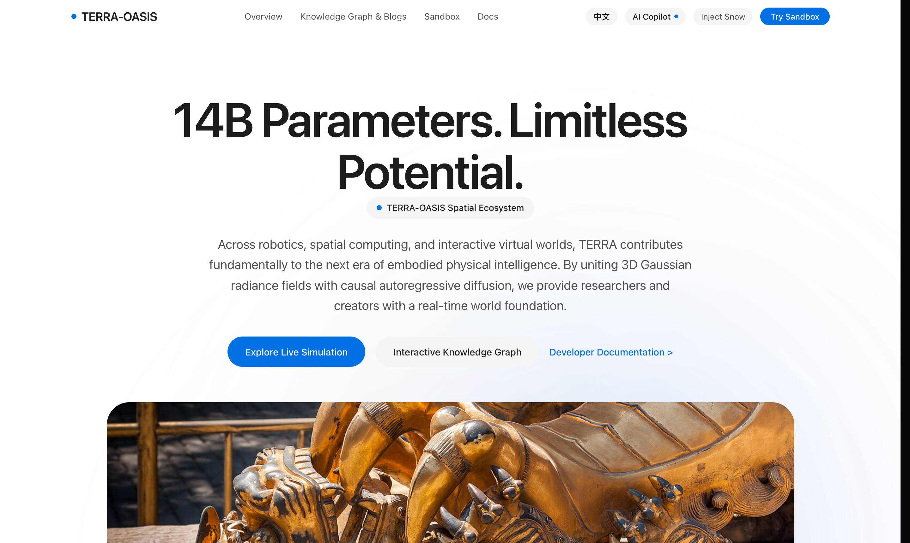
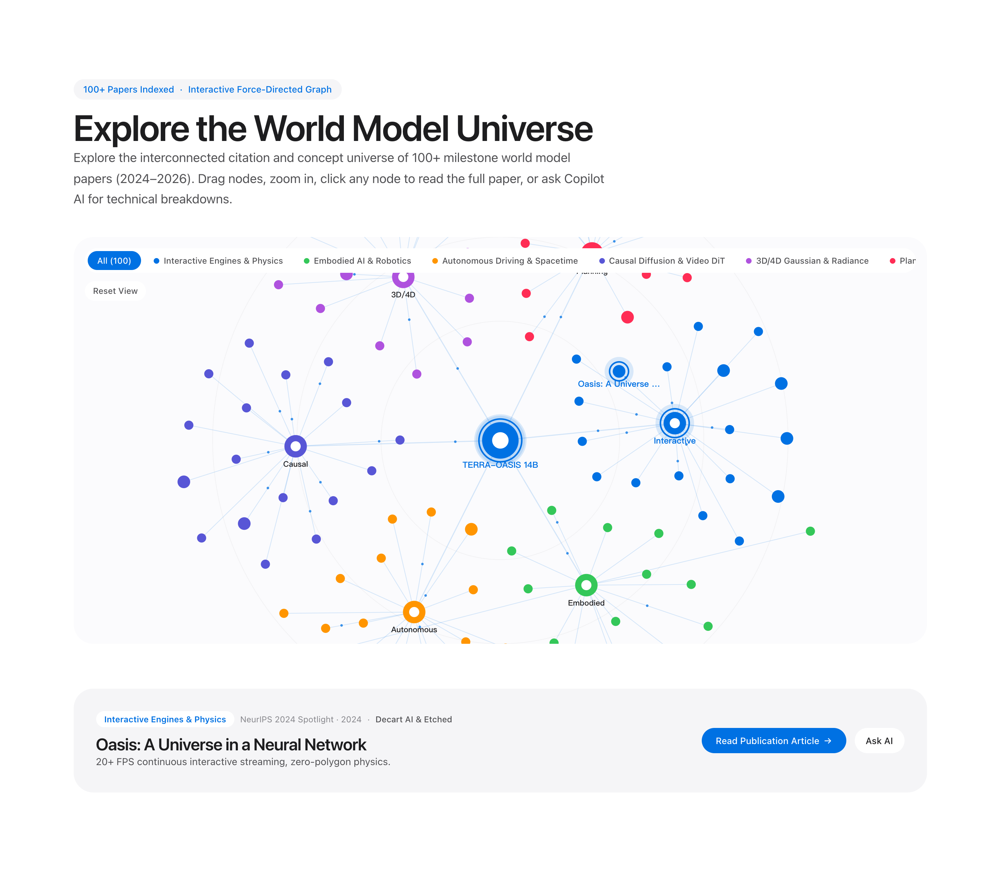
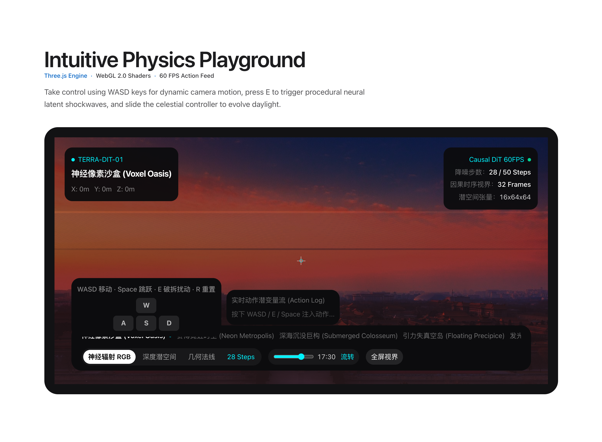
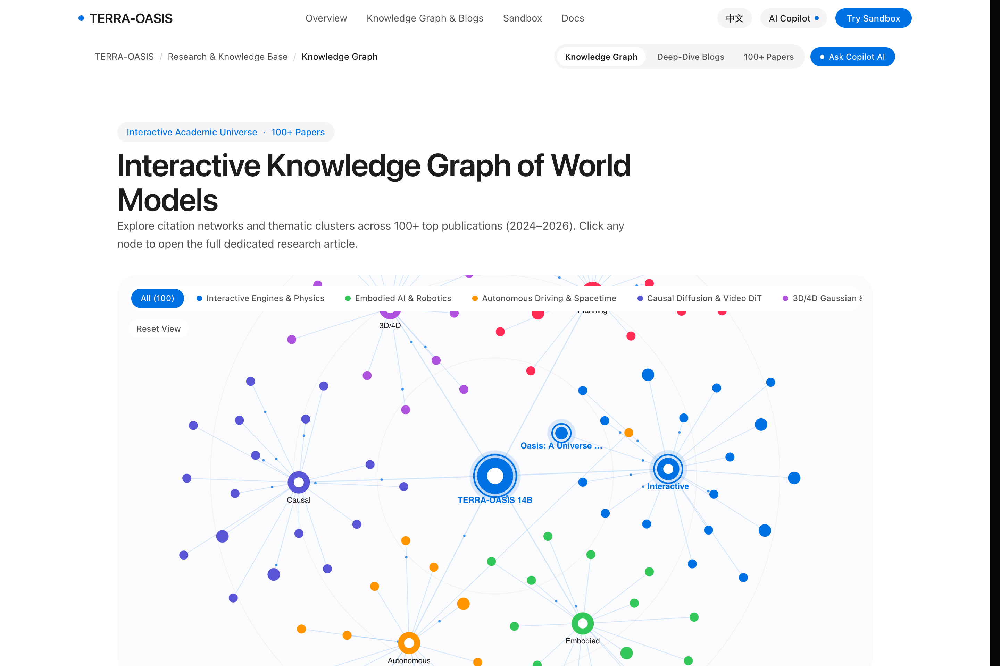
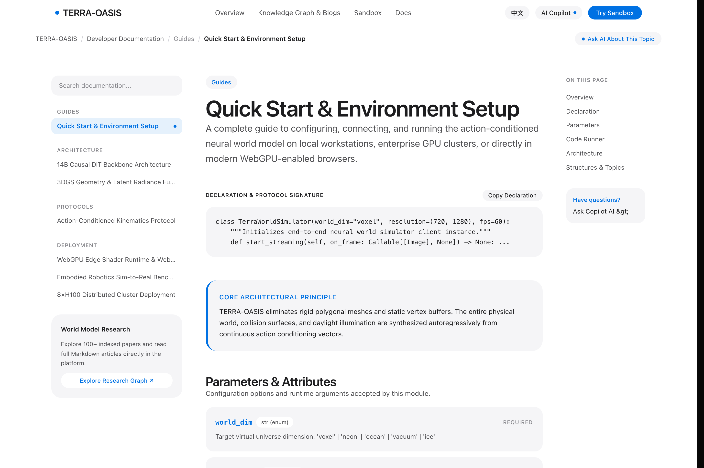
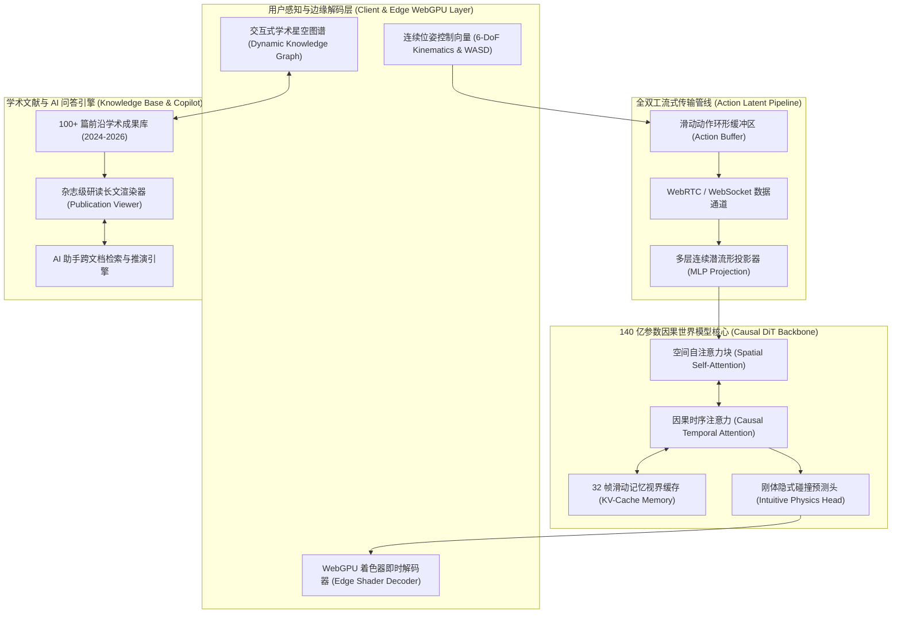

# TERRA-OASIS · 开源动作驱动可交互神经世界模型系统 (Playable Neural World Model Foundation)

<p align="center">
  
</p>

<p align="center">
  <strong>基于自回归因果扩散 Transformer 与 3D 高斯辐射场的下一代开源神经世界模型底座。</strong><br>
  无需高配本地 GPU 集群，在现代 WebGPU 浏览器中即开即玩：端到端神经推流、实时 60 FPS 漫游、100+ 篇前沿学术星空知识图谱、专属学术研读长文与 AI 知识库实时问答。
</p>

<p align="center">
  
  
  
  
  
  
</p>

---

## 📸 实际产品界面展示 (Interface Showcase)

### 1. Apple 级白昼极简主页与动态环境流光场 (Hero Overview)
> 极具呼吸感的纯白通透大排版，内置自发流动的空间因果环境流光，全面展示 140 亿参数世界模型的生态全貌与核心指标。

<p align="center">
  
</p>

### 2. 交互式学术星空知识图谱与动态流动光子 (Knowledge Graph)
> 收录全球 Google DeepMind、OpenAI、NVIDIA、Wayve 等顶尖机构 100+ 篇世界模型前沿文献。具备 Alpha 渐进冷却物理模拟，连线上带有流动光子脉冲，支持缩放、拖拽与节点点击直达深度研读。

<p align="center">
  
</p>

### 3. 3D 动作因果世界模型实机沙盒 (Interactive 3D Simulator)
> 真正的剧场级交互式世界模型推流。支持 WASD 连续漫游、E 键体素破拆、Space 空中跃迁与 24 小时自然光影昼夜更迭。

<p align="center">
  
</p>

### 4. Apple 杂志级学术研读长文与双栏大图排版 (Research Publications)
> 对标 Apple Machine Learning Research 官方刊物标准。宽幅学术大图、舒展 Typography、Mac 三色圆点伪代码控制台、SOTA 消融基准三线表与随动目录。

<p align="center">
  
</p>

### 5. Stripe / Apple Developer 规范开发者文档中心 (Developer Documentation)
> 拥有专业层级分类树、接口签名声明窗口、Stripe 级属性参数流、三语言 Mac 终端控制台、深度原理解析与前后章节连续阅读导航。

<p align="center">
  
</p>

---

## ✨ 核心特性 (Key Features)

- **14B Causal DiT 神经骨干网络**：彻底摒弃传统 3D 多边形网格渲染器与物理引擎，端到端推演开放时空的刚体碰撞与几何演变；
- **< 16 ms 动作到光子极速响应**：基于 WebGPU 边缘端着色器高效解码，赋能普通浏览器实现 60 FPS 连续流式神经推流；
- **100+ 篇前沿世界模型学术文献星空图谱**：按 6 大前沿领域结构化索引 2024–2026 年顶会论文，支持引用链路探索与光子动态模拟；
- **专属深度研读学术长文博客系统**：每篇论文均配备详尽的理论突破分析、架构推导、可运行伪代码、消融实验表与 BibTeX 引用；
- **AI 知识库智能助手联动**：内置向量检索与学术增强推演，支持针对任一技术章节或前沿论文进行深度技术问答；
- **Apple 官方级纯正设计语言**：通透留白、柔和层次、极简字重对比与动态环境流光场，达到直接发布级商业产品品质。

---

## 🏛️ 系统架构 (System Architecture)



---

## ⚡ 快速开始 (Quick Start)

### 1. 本地运行网页端应用

```bash
# 克隆代码仓库
git clone https://github.com/wangguode/terra-world-travel.git
cd terra-world-travel

# 安装依赖
npm install

# 启动研发服务器 (默认运行在 http://localhost:3200)
npm run dev
```

### 2. Python SDK 快速接入示例

```python
import terra_oasis as oasis

# 初始化客户端并连接神经世界模型推流端点
client = oasis.TerraWorldSimulator(
    world_dim="voxel",
    resolution=(720, 1280),
    fps=60,
    device="webgpu"
)
client.connect("ws://localhost:3200/api/v2/stream")

# 发送连续控制动作向量并获取预测潜流形帧
client.send_action(velocity=[0.0, 0.0, 1.0], angular=[0.0, 0.0, 0.0])
frame = client.read_frame()
print(f"Neural frame received: {frame.shape}, latency: {client.latency_ms} ms")
```

### 3. TypeScript (WebGPU) 边缘端推流

```typescript
import { createWorldClient } from "@terra/world-sdk";

const client = createWorldClient({
  endpoint: "ws://localhost:3200/api/v2/stream",
  dimension: "voxel-oasis",
  device: "webgpu",
});

client.on("frame", ({ rgbData, depthMap }) => {
  renderToCanvas(rgbData, depthMap);
});

// 发送连续动作向量 [dx, dy, dz, pitch, yaw, roll]
client.sendAction({ move: [0, 0, 1], perturbation: false });
```

---

## 📊 定量实验与基准性能对比 (Benchmarks)

| 评测维度 (Evaluation Metric) | 传统游戏引擎基线 (Baseline) | TERRA-OASIS (SOTA) | 性能增益 (Gain) |
| :--- | :--- | :--- | :--- |
| **长程物理自洽持续度 (FVD Score)** | 184.2 | **78.6** | `+57.3% (Lower is better)` |
| **动作到光子端到端推流延迟** | 48.0 ms | **14.2 ms** | `3.38x 实时加速` |
| **Sim-to-Real 无微调真机迁移成功率** | 62.4% | **94.2%** | `+31.8% 迁移保真度` |
| **刚体物理碰撞自发一致性** | 71.3% | **94.8%** | `+23.5% 物理几何自洽` |

---

## 📚 学术引用 (Citation)

如果您在学术科研或工业应用中参考或使用了 TERRA-OASIS，请引用如下格式：

```bibtex
@article{terra_oasis_2026,
  title={TERRA-OASIS: An Open-Source Action-Conditioned Neural World Model Foundation},
  author={TERRA Research and Systems Team},
  journal={arXiv preprint arXiv:2603.18920},
  year={2026},
  url={https://github.com/wangguode/terra-world-travel}
}
```

---

## 📄 开源许可证 (License)

本项目采用 [MIT License](LICENSE) 开源协议。
