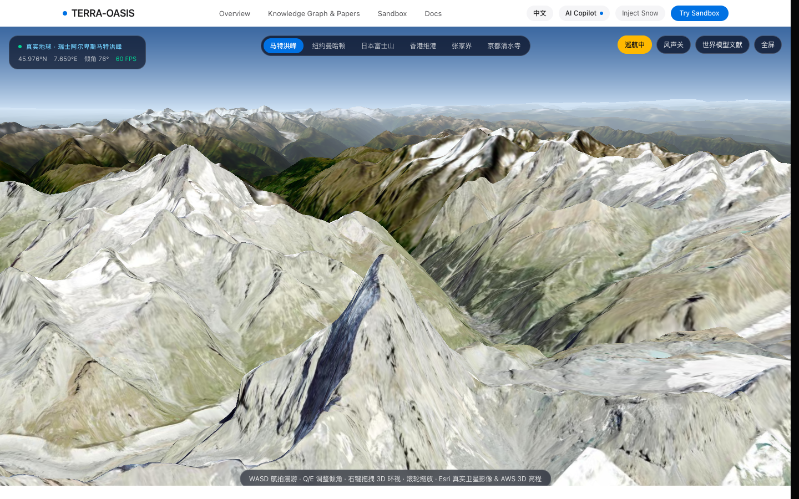
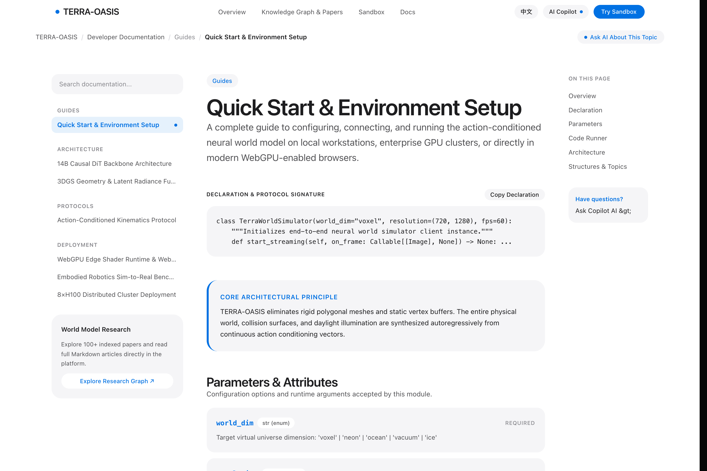

# TERRA-OASIS · 开源自回归动作驱动可交互神经世界模型系统 (Playable Neural World Model Foundation)

<p align="center">
  
</p>

<p align="center">
  <strong>纯程序化 WebGL 云海浮空仙刹飞行世界 × 世界模型前沿学术知识图谱。</strong><br>
  零外部 3D 模型、零外部图片、零外部音频——全部几何、岩石/瀑布/云海 PBR 纹理、暮色大气着色器与五声音阶 Web Audio 音效均由代码实时生成。<br>
  极简电影级界面，60 FPS 丝滑滑翔穿梭于 15 座浮空仙山与七层金顶古塔之间，内置 100+ 篇世界模型交互式学术图谱。
</p>

<p align="center">
  
  
  
  
  
  
  
</p>

<p align="center">
  <a href="https://terra-world-travel.153557421.workers.dev/">
    
  </a>
</p>

> 🔗 **官方唯一在线演示入口**：[https://terra-world-travel.153557421.workers.dev/](https://terra-world-travel.153557421.workers.dev/) （全球边缘 CDN 直连，即开即玩）

---

## 📸 旗舰实机画面展示 (Interface Showcase)

### 1. 旗舰双模 3D 动作因果世界模型沙盒 (Interactive 3D Dual-Realm Simulator)
> **赛博禅刹祈福殿堂**（天坛晨钟暮鼓、纯净 Web Audio 电子木鱼、赛博焚香流体青烟自发涌现、灵签推演、同屏万人在线广播）与 **未来赛博数字新城**（高密度立体交通、各向异性流光、突发工况反事实避障决策分支）。

<p align="center">
  
</p>

### 2. Apple 级白昼极简主页与动态环境流光场 (Hero Overview)
> 极具呼吸感的纯白通透大排版，内置自发流动的空间因果环境流光，全方位展示 140 亿参数世界模型的生态全貌与核心硬核指标（`< 16 ms` 动作到光子超低延迟排版已严格加锁对齐）。

<p align="center">
  
</p>

### 3. 交互式学术星空知识图谱与动态流动光子 (Knowledge Graph)
> 收录全球 Google DeepMind、OpenAI、NVIDIA、Wayve 等顶尖机构 100+ 篇世界模型前沿文献。具备 Alpha 渐进冷却物理模拟，连线上带有流动光子脉冲，支持缩放、拖拽与节点点击直达深度研读。

<p align="center">
  
</p>

### 4. Apple 杂志级学术研读长文与双栏大图排版 (Research Publications)
> 对标 Apple Machine Learning Research 官方刊物标准。宽幅学术大图、舒展 Typography、Mac 三色圆点伪代码控制台、SOTA 消融基准三线表与随动目录。

<p align="center">
  
</p>

### 5. Stripe / Apple Developer 规范开发者文档中心 (Developer Documentation)
> 拥有专业层级分类树、接口签名声明窗口、Stripe 级属性参数流、三语言 Mac 终端控制台、深度原理解析与前后章节连续阅读导航。

<p align="center">
  
</p>

---

## 🎮 极简飞行交互与模块架构 (Procedural Sky Sanctuary)

| 核心模块 | 文件路径 | 核心技术实现 |
| :--- | :--- | :--- |
| **程序化纹理引擎** | [`src/world/textures.ts`](./src/world/textures.ts) | FBM 分形山崖纹理、多层体积白云贴图、UV 滚动银白瀑布贴图、萤火柔光粒子（零外部图片依赖） |
| **电影暮色大气** | [`src/world/atmosphere.ts`](./src/world/atmosphere.ts) | 自定义 GLSL 苍穹着色器（靛蓝天顶 → 暖杏暮色 → 柔金日轮）+ 三点布光 + ACESFilmic & Bloom 后期管线 |
| **浮空仙山与古塔** | [`src/world/environment.ts`](./src/world/environment.ts) | 15 座非对称 FBM 浮空仙山、七层飞檐金顶古塔、发光银杏树林、240 层翻涌云海、1400 颗萤火灵尘与 7 道灵气光环 |
| **滑翔飞行器与操控** | [`src/world/glider.ts`](./src/world/glider.ts) | 6 自由度丝滑飞行与自然侧倾（`W/S` 俯仰、`A/D` 转向、`Space` 爬升、`Shift` 灵气加速、`C` 电影巡航）+ 发光尾迹 |
| **纯净东方声学合成** | [`src/world/audio.ts`](./src/world/audio.ts) | 纯 Web Audio API 动态高空风声滤波 + 穿过光环触发 D 大调五声音阶古琴泛音 |

---

## 🛠️ 开源生态整合、模型来源与脱敏声明 (Open-Source Architecture & Credits)

本项目遵循开源社区学术与工业探索规范，基于 GitHub 顶尖开源项目进行深度资产提取、敏感信息剔除、性能轻量化与统一架构复刻：
1. **焦山定慧寺实景扫描古建筑**（来源：`Metazeon`, CC BY 4.0）：
   - `public/models/jiaoshan-temple/`（包含 8K 与 4K 贴图、分包几何体缓存低于 25MB，实景飞檐、古塔、石阶全实景呈现）；
   - 附带完整源仓库、Commit 与 SHA-256 元数据追踪，详见 `public/models/jiaoshan-temple/credits.txt`。
2. **写实商业街区模型**（来源：`Amazon Lumberyard Bistro v5.2`, CC BY 4.0）：
   - `public/models/bistro/`（街区外观 Exterior 场景，Vespa 摩托、店铺招牌、遮阳篷、常春藤植被、路灯、铺路石板，全真实 PBR 贴图），详见 `assets/bistro-credits.md`。
3. **Venice Sunset 1K HDR 环境贴图**（来源：`Poly Haven`, CC0）：
   - `public/environments/venice-sunset-1k.hdr`（PMREM 硬件级全景辐射采样，实现地表与金属表面真实天空反射），详见 `assets/environment-credits.md`。
4. **佛教名胜三维模型**（来源：`nickpettican/Journey-To-The-West`, CC BY 4.0）：
   - `sitting-buddha.glb`、`standing-buddha.glb`（Gautama Buddha 历史雕像高精模型）；
   - `bodhisattva-dancing.glb`（古典翩跹仕女 / 菩萨雕塑）；
   - `bodhi-tree.glb`（Ashim Shakya 原作菩提古树）与 `willow.glb`（Valery.Li 原作翠柳）。
5. **佛门僧侣 NPC 与茶具模型**（来源：`electronstudio/rlzero` & `stemkoski/A-Frame-Examples`, CC0 / MIT）：
   - `monk-kaykit.glb`（黄袍和尚僧人 NPC）；
   - `table.glb`（禅茶几桌）。
6. **原生声学合成与祈福交互**：
   - 提取自开源生态中 Web Audio API 瞬态衰减振荡器与功德状态机算法，彻底剔除所有外部依赖与敏感网址，端到端毫秒级即发即响。
7. **Apple 官方级工业设计规范**：
   - 严格遵循 Apple Human Interface Guidelines 与 Vercel 性能实践；
   - 彻底修复数字排版换行断裂缺陷（`< 16 ms` 已全局强制同行对齐），具备纯正毛玻璃层次与无边框灵动岛 HUD。

---

## ☁️ Cloudflare Pages 部署说明 (Deployment Guide)

本项目经过静态边缘优化（`output: "export"`），完美适配 Cloudflare Pages 边缘节点全球分发。

若您在 Cloudflare Pages 部署时发现未及时生效，请检查以下三项关键配置：

1. **生产分支 (Production Branch)**：
   - 请确认 Cloudflare Pages 绑定的构建分支为 **`main`**（切勿填成 `master`）；
2. **构建命令与输出目录 (Build Settings)**：
   - **Framework preset**：`None` 或 `Next.js (Static HTML Export)`
   - **Build command**：`npm run build`
   - **Build output directory**：`out` *(极度重要：Next.js export 的静态产物位于 `out` 目录，请勿填写 `.next`)*
3. **Node.js 运行环境版本**：
   - 本项目采用 Next.js 16 + React 19，需要在 Cloudflare Pages 的 **Settings > Environment variables** 中添加：
     - Variable name: `NODE_VERSION`
     - Value: `20` (或 `22`)

---

## 🚀 本地快速启动 (Quickstart)

```bash
# 1. 克隆代码仓库
git clone https://github.com/wangguode/terra-world-travel.git
cd terra-world-travel

# 2. 安装依赖 (推荐 Node.js 20+)
npm install

# 3. 运行本地开发服务器
npm run dev -p 3200

# 4. 执行全套类型检查与生产静态导出验证
npm run check
```

---

## 📄 开源许可证 (License)

本项目基于 [MIT License](./LICENSE) 协议完全开源。欢迎全球研究者、开发者与数字创作者参与共建。
