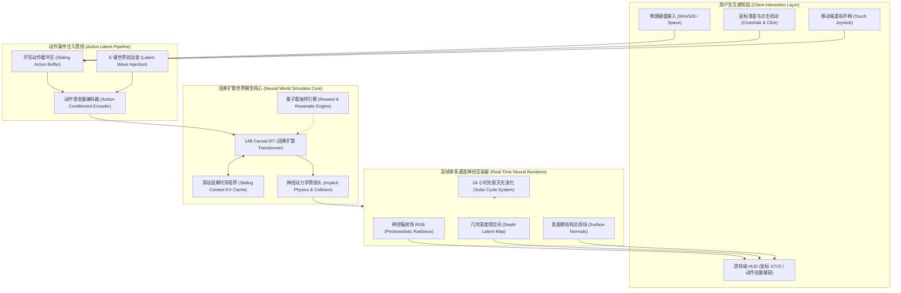

# TERRA-OASIS · 开源动作驱动可交互神经世界模型应用 (Playable Neural World Simulator)

<p align="center">
  
</p>

<p align="center">
  <strong>首个面向现代 Web 浏览器的动作条件自回归神经世界模型应用（Action-Conditioned Neural World Model Web Application）。</strong><br>
  无需配置 8×H100 昂贵 GPU 集群，即开即玩：轻按键盘 WASD 实时漫游、E 键触发体素破拆扰动、Space 空中跃迁，体验纯神经网络端到端推演的时空因果。
</p>

<p align="center">
  
  
  
  
  
</p>

---

## 1. 什么是世界模型应用？（Why Terra-Oasis?）

传统计算机图形学与游戏引擎（Unreal Engine / Unity）依赖于显式手工构建的三维资产：多边形网格（Meshes）、UV 展开贴图、刚体包围盒碰撞体，以及硬编码的牛顿运动学公式。

**TERRA-OASIS 标志着全新范式的到来：**
- **无需 3D 多边形网格**：世界内不存在预设的几何面片与光照烘焙；
- **动作驱动自回归推演（Action-Conditioning）**：模型将用户的连续操作（WASD 位移、跳跃、视角旋转、破拆破坏）作为潜变量特征输入；
- **全端到端时空因果预测**：神经网络根据历史时空因果注意力，端到端直接预测下一帧画面、物理反弹与光影折射；
- **即开即玩的 Web 客户端应用**：不是孤立的权重文件或纯后端脚本，而是一套拥有实时 HUD 遥测、动作捕捉流记录、多通道渲染（RGB / 深度场 / 法线场）与物理干预面板的完整交互式应用程序。

---

## 2. 神经世界模型 vs 传统 3D 引擎

| 维度对比 | 传统游戏引擎 (Unreal / Unity) | TERRA-OASIS 神经世界模型应用 |
| :--- | :--- | :--- |
| **世界表达媒介** | 显式几何多边形网格 (3D Mesh + UVs) | 隐式神经潜空间表征 (Action Latents & Causal Features) |
| **物理碰撞逻辑** | 离散物理引擎硬编码 (PhysX / Havok) | 神经网络内化自发涌现 (Learned Intuitive Physics) |
| **时空连续性** | 依靠代码逐帧执行逻辑脚本 | 因果自回归扩散预测 (Autoregressive Diffusion) |
| **地形破拆交互** | 复杂体素网格实时布尔运算 (开销巨大) | 局部潜变量噪声注入，自适应神经补全与重构 |
| **跨设备门槛** | 需下载数十 GB 客户端资产包与高端显卡 | 现代 Web 浏览器即开即玩，跨移动端触控秒级启动 |

---

## 3. 系统全景架构图 (Architecture Overview)



---

## 4. 五大沙盒世界维度 (Interactive Dimensions)

应用内置 5 个具备不同物理法则与光学特征的神经沙盒时空：

1. **神经像素沙盒 (Voxel Oasis · `TERRA-DIT-01`)**
   - *特点*：像素立方体自回归世界，支持按下 `E` 键在视线前方注入几何扰动，实时观察体素破拆与神经因果重构；
   - *物理约束*：重力 $9.8\,m/s^2$ · 因果视界 32 Frames · 默认降噪步数 24 Steps。
2. **赛博霓虹时空 (Neon Metropolis · `TERRA-DIT-02`)**
   - *特点*：高密度垂直都市，模拟湿润路面的各向异性光斑、雨滴流体与远景菲涅尔反射；
   - *物理约束*：重力 $9.8\,m/s^2$ · 因果视界 48 Frames · 极高反射率。
3. **深海沉没巨构 (Submerged Colosseum · `TERRA-DIT-03`)**
   - *特点*：水下古代石拱遗迹，沉浸模拟体散射焦散光斑与微重力悬浮漫游；
   - *物理约束*：重力 $2.1\,m/s^2$ · 阻尼 $0.65$ · 浮力加速度推进。
4. **引力失真空岛 (Floating Precipice · `TERRA-DIT-04`)**
   - *特点*：对流层上方的反重力岩石岛屿群，测试非欧几何与反向加速度连续生成；
   - *物理约束*：重力 $-1.5\,m/s^2$ · 极低阻力 · 滑翔真空推进。
5. **发光能量林地 (Bioluminescent Grove · `TERRA-DIT-05`)**
   - *特点*：深邃森林与自发光真菌孢子，测试世界模型在低光环境下的因果记忆保持力；
   - *物理约束*：重力 $7.2\,m/s^2$ · 有机光斑扩散 $450\,nm$ 波段。

---

## 5. 操作控制指南 (Interactive Controls)

| 按键 / 操作 | 交互功能 | 神经系统动作说明 |
| :--- | :--- | :--- |
| **`W / A / S / D`** | 水平平移与前进后退 | 连续注入位移速度矢量，驱动因果视差积分 |
| **`Space`** | 向上跃迁 / 跳跃 | 施加垂直冲量，激活重力模拟因果回弹 |
| **`Shift + WASD`** | 冲刺加速 | 动力学加速度提升 200%，加快时空探索推演 |
| **`E` 或 鼠标单击** | **世界扰动破拆 (Block Break)** | 在视线中心注入局部潜变量形变冲击波，测试模型自愈与形变 |
| **`R`** | **量子重抽样 (Reseed)** | 重新收敛全局随机隐空间种子，瞬间重构世界分支 |
| **渲染通道切换** | RGB / 深度图 / 法线场 | 实时透视神经网络内部对场景几何与深度的隐式表征 |
| **时间演化滑块** | 00:00 ~ 24:00 全日光影 | 实时改变太阳矢量与天空色温，推演光影实时流转 |

---

## 6. 快速开始 (Quick Start)

### 环境要求
- Node.js 18.0 或更高版本
- 支持 WebGL / WebGPU 的现代浏览器 (Chrome 113+ / Safari 17+ / Edge)

### 本地启动

```bash
# 1. 克隆代码仓库
git clone https://github.com/wangguode/terra-world-travel.git
cd terra-world-travel

# 2. 安装依赖项
npm install

# 3. 启动本地交互开发服务器
npm run dev
```

启动完成后，在浏览器中打开 `http://localhost:3200`，即可立即体验可交互神经世界模型应用。

### 质量与构建检查

```bash
# 运行完整工程质量门禁 (Lint + TypeScript 严格类型检查 + Next.js 生产构建)
npm run check
```

---

## 7. 开源协议 (License)

本项目基于 [MIT 许可证](LICENSE) 开源。欢迎所有致力于世界模型（World Model）、具身仿真与次世代神经图形学研究的开发者自由探索、构建与贡献！
