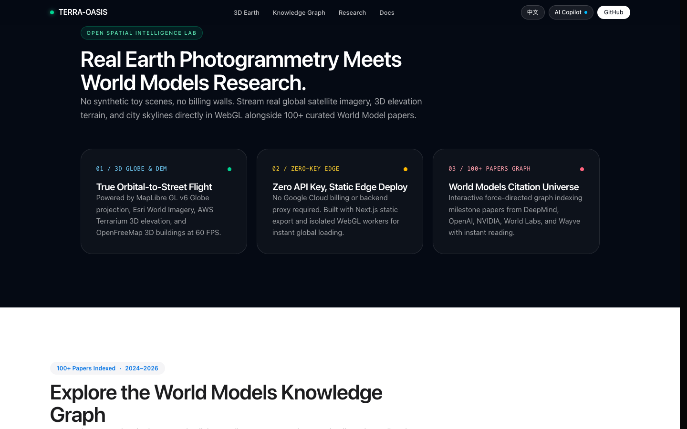
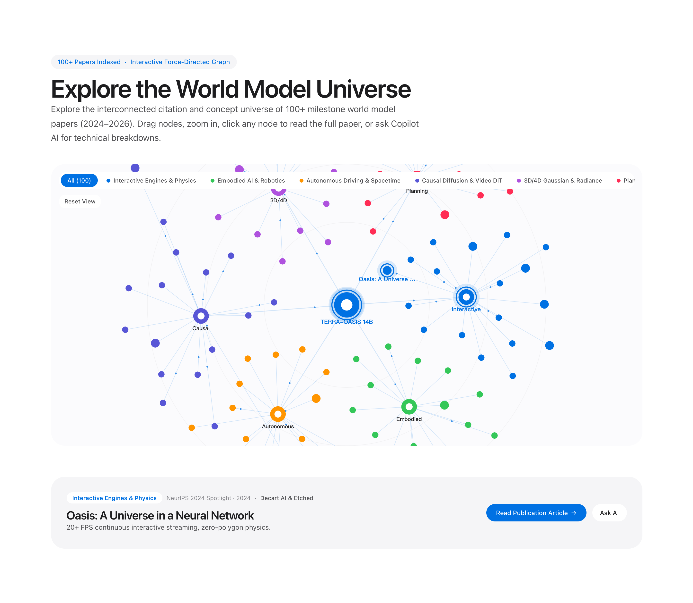
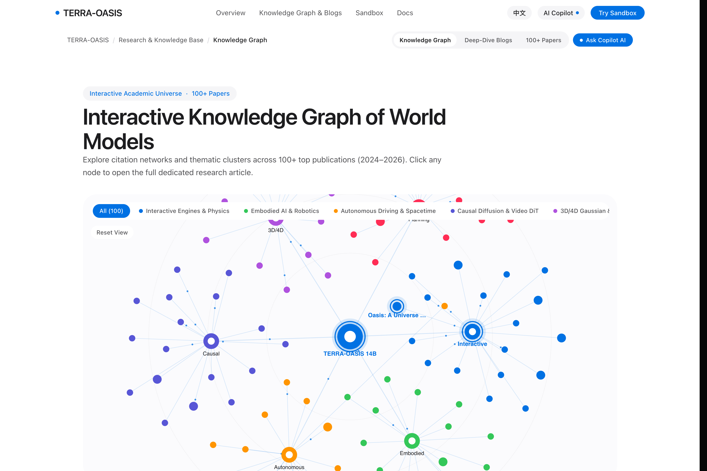

# TERRA-OASIS · Real-World 3D Earth Explorer & World Models Research Hub

<p align="center">
  
</p>

<p align="center">
  <strong>浏览器端真实地球 3D 卫星地形与城市天际线漫游器 × 100+ 篇世界模型学术知识图谱</strong><br>
  基于 MapLibre GL JS + Esri 全球卫星实景影像 + AWS Terrarium 3D 高程 + OpenFreeMap 3D 建筑，<strong>零 API Key、零计费依赖、纯前端 60 FPS 秒开</strong>。
</p>

<p align="center">
  
  
  
  
  
  
</p>

<p align="center">
  <a href="https://terra.statementflow.win">
    
  </a>
</p>

> 🔗 **在线体验**：[https://terra.statementflow.win](https://terra.statementflow.win) （Cloudflare 全球边缘静态分发，打开即飞）

---

## 📸 实机画面展示 (Interface Showcase)

### 1. 真实地球 3D 卫星地形与城市天际线漫游器 (Real-World 3D Earth Explorer)
> 拒绝虚拟低模与 Demo 感——直接加载真实地球高分卫星影像、3D 数字高程模型（DEM）与城市 3D 建筑体块。内置 **6 大真实世界航拍地标**（瑞士马特洪峰、纽约曼哈顿、日本富士山、香港维港、湖南张家界、京都清水寺），支持 `WASD` 自由航拍、`Q/E` 倾角调节、360° 电影巡航与 Web Audio 动态高空风声。

<p align="center">
  
</p>

### 2. 极简白昼产品概览 (Hero Overview)
> 面向空间智能与世界模型研究者的现代产品化界面，提供清晰架构索引与实时交互入口。

<p align="center">
  
</p>

### 3. 交互式世界模型学术知识图谱 (Knowledge Graph & 100+ Papers)
> 系统收录 Google DeepMind、OpenAI、NVIDIA、World Labs、Wayve 等机构的 **100+ 篇世界模型前沿文献**。支持物理力学布局、缩放拖拽与节点点击直达深度研读。

<p align="center">
  
</p>

### 4. 学术研读长文与开发者文档中心 (Research & Docs)
> 内置杂志级学术长文排版（`/research`）与开发者接口参考文档（`/docs`），覆盖空间智能、视频世界模型与神经渲染核心脉络。

<p align="center">
  
</p>

---

## 🧭 技术架构与核心能力 (Architecture)

| 模块 | 实现文件 | 技术方案与亮点 |
| :--- | :--- | :--- |
| **真实地球 3D 引擎** | [`src/components/true-3d-world-game.tsx`](./src/components/true-3d-world-game.tsx) | MapLibre GL JS v5 + 独立静态 Worker（`public/vendor/maplibre-gl-worker.js`），完整兼容 Next.js 静态导出 |
| **全球公开数据源** | 零 Key 零计费 | Esri ArcGIS World Imagery（卫星实景）+ AWS Terrarium Tiles（3D DEM 高程）+ OpenFreeMap Planet（3D 城市建筑） |
| **自由航拍与巡航** | 键盘 + 鼠标 + HUD | `WASD` 航拍飞行、`Q/E` 俯仰倾角、右键拖拽 3D 环视、滚轮缩放、`C` 键电影巡航、实时 GPS 经纬度与 FPS 遥测 |
| **动态声学引擎** | [`src/world/audio.ts`](./src/world/audio.ts) | 纯 Web Audio API 实时合成高空气流风声，零外部音频资源 |
| **世界模型知识图谱** | [`src/components/knowledge-graph-canvas.tsx`](./src/components/knowledge-graph-canvas.tsx) | 100+ 篇经典与前沿 World Model 论文脉络可视化与检索 |
| **自动化视觉验证** | [`scripts/verify-world.mjs`](./scripts/verify-world.mjs) | Playwright 自动化真机渲染检验（马特洪峰 / 曼哈顿 / 富士山 / 移动端 375px 零溢出） |

---

## 🚀 本地快速启动 (Quickstart)

```bash
# 1. 克隆代码仓库
git clone https://github.com/wangguode/terra-world-travel.git
cd terra-world-travel

# 2. 安装依赖 (推荐 Node.js 20+)
npm install

# 3. 启动本地开发服务器
npm run dev

# 4. 代码检查、类型检查与静态导出构建
npm run lint && npm run typecheck && npm run build -- --webpack
```

---

## ☁️ 静态边缘部署 (Cloudflare Pages / Workers)

本项目使用 Next.js `output: "export"` 纯静态导出，无需后端服务器与 API Key 环境变量：
- **Build command**：`npm run build -- --webpack`
- **Build output directory**：`out`
- **Node.js**：`20+`

---

## 📄 开源许可证 (License)

本项目基于 [MIT License](./LICENSE) 协议开源。卫星与地理数据版权归各自开放数据源提供方（Esri World Imagery / AWS Open Data Terrarium / OpenFreeMap & OpenStreetMap contributors）所有。
