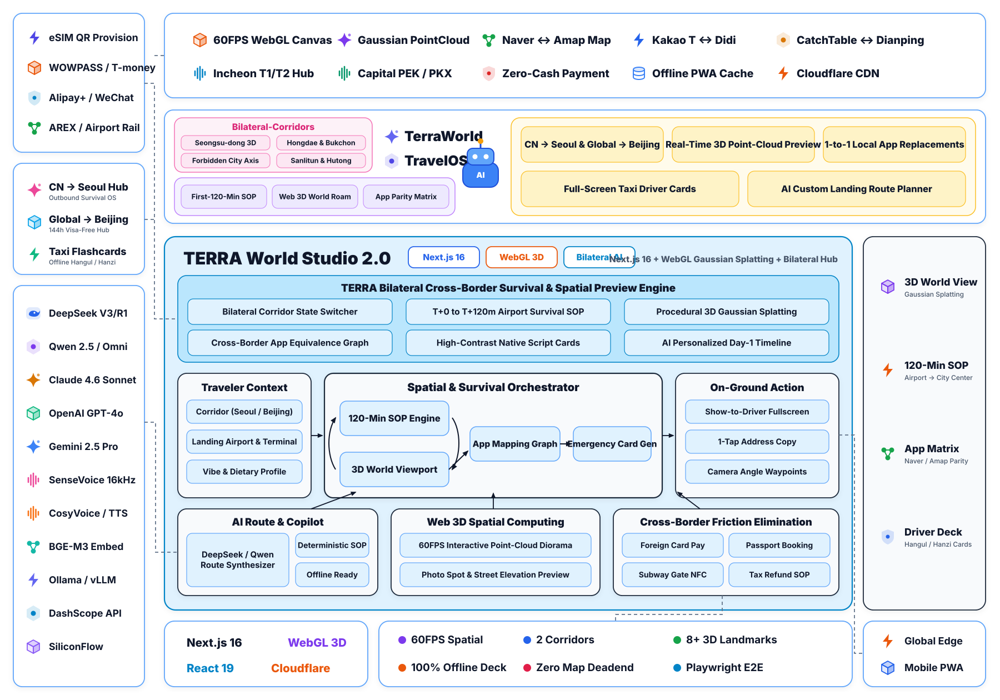

# TERRA // 跨国落地生存指南与 3D 空间世界模型旅游平台 (Seoul & Beijing Edition)

> **解决跨国自由行「下飞机前 120 分钟」的断网、换汇、地图失效、打车语言不通痛点，并通过 Web 3D 高斯点云（3D Gaussian Splatting）世界模型视窗，在出发前 1:1 沉浸预演首尔与北京核心地标动线。**

---

## 1. 为什么做这个项目？（核心痛点破局）

传统旅游网站只堆砌泛泛的图文游记，却忽略了跨国旅行者落地瞬间的**生存断层（Touchdown Survival Gap）**：
1. **中国旅客第一次去韩国首尔（`CN → Seoul`）**：
   - 下仁川/金浦机场后国内手机卡漫游慢或断网；
   - 打开习惯的 **Google Maps 发现因韩国测绘法规限制无法步行与驾车导航**；
   - 路边摊、公交地铁与独立咖啡馆不支持微信支付；
   - 圣水洞、弘大网红店全靠韩国本土 **CatchTable** 排队，街头拦不到出租车。
2. **国际旅客及外地游客去中国北京（`Global & CN → Beijing`，由 `testUi-1` 全面升维）**：
   - 99% 场景无现金化，急需 **Alipay 外卡免密直绑** 与 **BEIJING PASS**；
   - 故宫、国家博物馆实行严格的**提前 7 天实名预约制**，且 90% 游客误走天安门广场安检长队（不知晓**东华门筒子河 8 分钟免排安检捷径**）；
   - 颐和园、什刹海胡同面积庞大，缺少立体空间方位的直观预演。

---

## 2. 系统架构图（全景空间神经世界模型架构）

<p align="center">
  <picture>
    <source media="(prefers-color-scheme: dark)" srcset="./docs/assets/architecture-dark.svg">
    
  </picture>
</p>

> 架构设计遵循 AgentScope 2.0 工业级全景架构范式，涵盖左侧协议/双向走廊/模型生态、顶部 3D 渲染与全球边缘基础设施、中上部双向走廊能力胶囊与品牌核心、中央 60FPS 空间漫游与双城动线引擎、右侧离线卡与 SOP 工具链，以及底部运行时可观测体系。支持随 GitHub 主题自动在明亮/暗色模式间切换。

---

## 3. 核心功能模块一览

| 模块编号 | 功能名称 | 韩国首尔走廊 (`CN → Seoul`) | 中国北京走廊 (`Global → Beijing`) |
| :--- | :--- | :--- | :--- |
| **01** | **下飞机黄金 120 分钟时间轴** | Airalo LG U+ eSIM → 仁川 B1F 申领 WOWPASS → 启用 Naver Map → 区分橙色直达/蓝色全停 AREX | 跨境双栈 eSIM → Alipay 外卡免密绑定 + BEIJING PASS → 故宫提前 7 天预约与东华门捷径 → 大兴/首都机场快轨 |
| **02** | **Web 3D 空间世界模型视窗** | 景福宫光化门至北岳山中轴、圣水洞演武场街红砖买手区、仁川机场 B1F 交通中心 | 故宫太和殿至景山万春亭 7.8km 中轴线、颐和园昆明湖十七孔桥、什刹海钟鼓楼与烟袋斜街胡同 |
| **03** | **本土必装 App 平替映射** | 高德 → `Naver Map`；滴滴 → `Kakao T / UT`；大众点评 → `CatchTable Global`；翻译 → `Papago` | Google Maps → `Amap English / Apple Maps`；Uber → `Alipay DiDi`；门票 → `Trip.com / 官方小程序` |
| **04** | **『给司机看』全屏双语大字卡** | 弘大 9 号口、明洞乐天总店、圣水洞 Dior 概念店、景福宫光化门、仁川 T1/T2 返程韩文全屏卡 | 故宫东华门（避开安检）、景山公园西门、颐和园新建宫门、什刹海鼓楼路口、大兴/首都机场大字卡 |
| **05** | **百炼 `qwen-plus` AI 动线引擎** | 根据航班落地时刻、停留天数与住宿区域实时生成带韩文打车指令的分步方案 | 根据抵京时刻与偏好实时生成皇城中轴线与胡同美食无折返方案 |

---

## 4. 本地快速启动与环境变量配置

```bash
# 1. 安装依赖
npm install

# 2. 复制环境变量模板并填入阿里云百炼 API Key（或任意 OpenAI 兼容接口）
cp .env.example .env.local

# 3. 启动本地开发服务器
npm run dev

# 4. 运行类型检查与生产构建验证
npm run check
```

> **安全说明（AI Call Safety）**：本项目严格遵循服务端密钥隔离规范，`.env.local` 已加入 `.gitignore`，任何 API 密钥均不会暴露在客户端 Bundle 或 Git 历史中。即使未配置 API Key，系统也会自动切换至内置的高可用确定性生存引擎。
